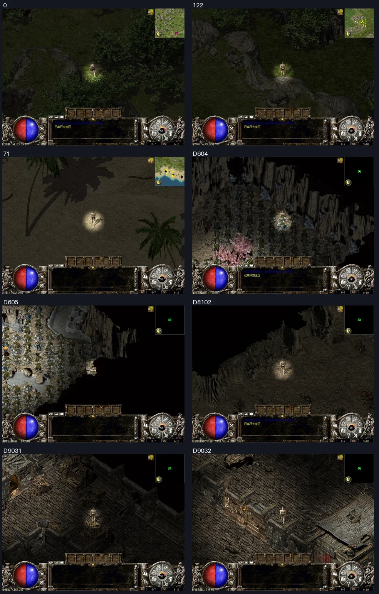

# Zircon 桌面端逐图走查 · 2026-11-26

**627 张登记地图均成功进入、加载并截图，626 张确认在同一图内走动。284 张有刷怪配置的地图全部通过这两项检查。** 本次在 Debian 上启动 Godot 4.6.3 .NET 桌面客户端，登录隔离的 ServerCore，使用修复提交 `912a7534` 和 `System.db` 2026.11.26.1（SHA-256 `5d472d613854d37f4e4faa940fe7bb8b87a42b518347d6f8c50764f55bab6bb1`）。正式服务、资料库、玩家存档和掌机未改动。

预览按行从左到右：比奇（`0`）、灌木林（`122`）、沙漠（`71`）、`D604`、`D605`、`D8102`、`D9031`、`D9032`。

- [逐图记录（CSV）](results.csv)：含地图 ID、加载尺寸、起止坐标、是否确认走动、截图路径和刷怪审计数量。
- [截图目录](screenshots/)：627 张从客户端视口直接抓取的截图，WebP 压缩保留原始截图尺寸。
- [截图 SHA-256](sha256sums.txt)：在本目录运行 `sha256sum -c sha256sums.txt` 校验。

## 检查方法

通过测试角色和 GM `@move` 逐图进入，核对服务端地图 ID 与客户端实际加载的地图文件，再发送一步普通移动请求，确认坐标更新后从客户端视口抓图。按 36 张左右分批，异常地图另开一轮复测。此次走查验证进图、渲染和一次短移动，不代表整张地图每条路径、所有传送门或每种怪的战斗行为都已测试。

刷怪数量来自同一数据库的独立服务端全量审计：284 张图、2,158 条规则，目标与实际均为 69,309，没有缺额。CSV 的 `nearby_monster_objects` 则仅是截图时客户端收到了多少附近的怪物类型对象，不是全图活怪数，也不保证这些对象都出现在画面上；一张图的截图不能用于证明整图密度均衡。

## 例外和复测

- `0_003`：有成功进图和截图记录。走动时触发传送，返回后截图；未确认一次留在原图内的移动。后续两次 GM 重试未确认进图。
- `4_001`：首轮未确认加载，复测批次通过。一次包含 `D001_001` 的批次在加载该图后出现本地进程内存分配器异常（`free(): invalid next size (fast)`），该图及随后五张图在复测中均正常加载、走动和截图；这次走查没有定位偶发异常的根因。
- `D8132`：首轮走动触发传送，复测确认同图走动。
- `d1602`：桌面测试加载了 `300×300` 版本，刷怪离线审计目录中的同名小写文件是不同的 `400×400` 版本。截图和走动只验证了桌面测试所用的版本；未替换任一资源。
